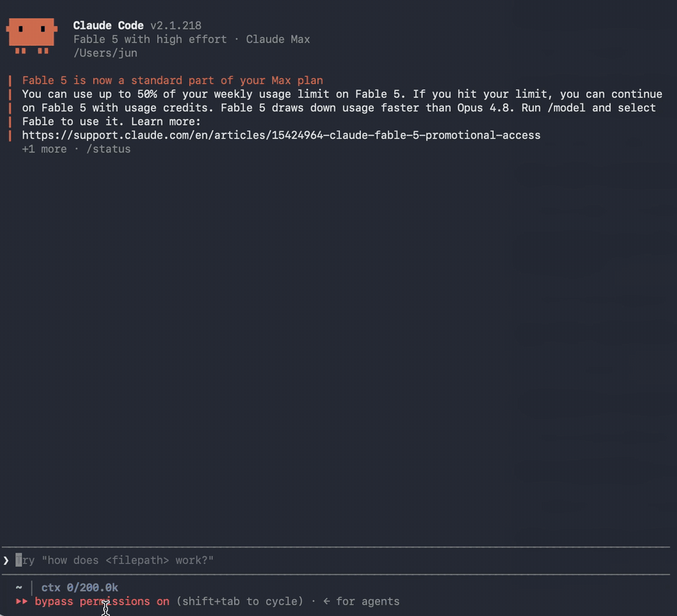
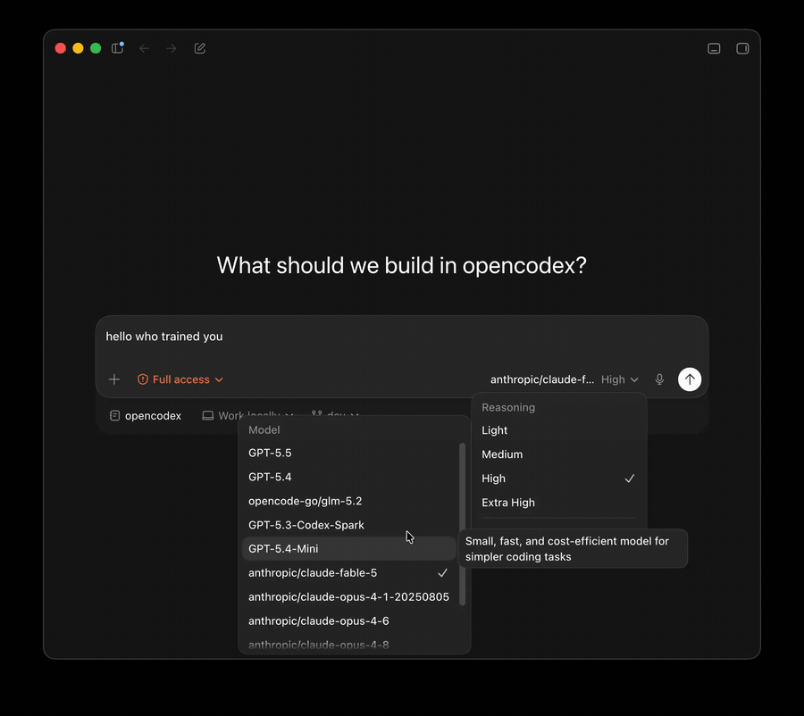
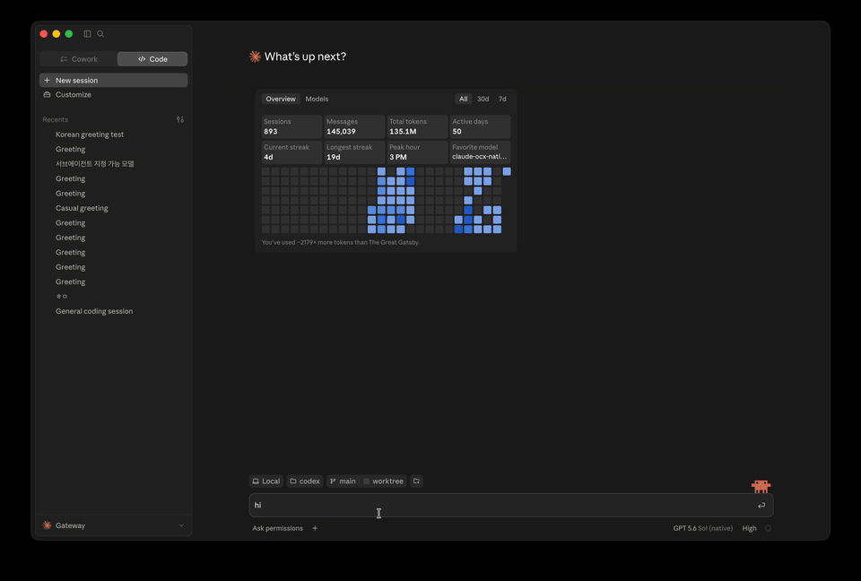
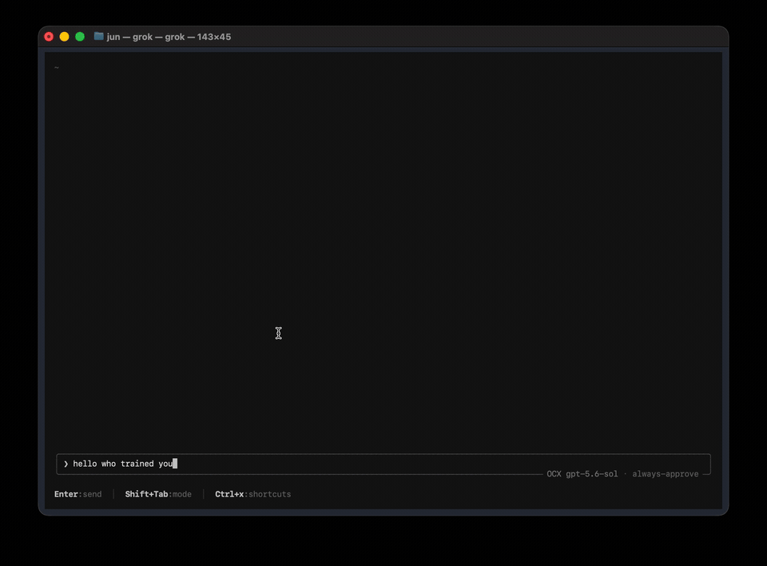

> **This repository is [SanHsien/opencodex](https://github.com/SanHsien/opencodex): a Windows-only maintenance fork of [lidge-jun/opencodex](https://github.com/lidge-jun/opencodex)** (MIT License; the copyright of the original author lidge-jun and the upstream contributors is retained). Product behavior follows the most recently synced upstream stable release (see [`tools/upstream_baseline.json`](tools/upstream_baseline.json) and [`docs/fork/UPSTREAM.md`](docs/fork/UPSTREAM.md)). macOS- and Linux-only content has been removed; see [FORK.md](FORK.md) for the maintenance policy and the upstream sync method. This project is not affiliated with or endorsed by OpenAI or Anthropic.

<h3 align="center">make codex open!</h3>
<p align="center"><b>Universal provider proxy for OpenAI Codex, Claude Code, Claude Desktop &amp; Grok Build (Windows)</b><br>
Install one MSI, and every one of them runs any LLM you point it at.</p>

<p align="center">
  <a href="https://github.com/SanHsien/opencodex/releases/latest"></a>
  <a href="LICENSE"></a>
  
</p>

<table>
<tr>
<td width="50%" valign="middle">

### Claude Code, running any model

The picker is stock Claude Code. The brain behind it isn't.

</td>
<td width="50%">
  
</td>
</tr>
<tr>
<td width="50%" valign="middle">

### Codex, running any model

Pick a provider and go — same workflow, different brain.

</td>
<td width="50%">
  
</td>
</tr>
<tr>
<td width="50%" valign="middle">

### Claude Desktop, running any model

Opus answers, then hands the task to a GPT-5.6 Sol subagent.

</td>
<td width="50%">
  
</td>
</tr>
<tr>
<td width="50%" valign="middle">

### Grok Build, running any model

Sol drives the session and calls a Kimi K3 subagent.

</td>
<td width="50%">
  
</td>
</tr>
</table>

<p align="center">
  <a href="README.en.md">English</a> · <a href="README.md">繁體中文</a> · 📖 <a href="https://opencodex.me/"><b>Full documentation →</b></a>
</p>

opencodex is a lightweight local proxy that translates Codex's Responses API into whatever your
provider speaks — streaming, tool calls, reasoning tokens, images, in both directions. Use Claude,
Gemini, Grok, GLM, DeepSeek, Kimi, Qwen, Ollama, or any other LLM with Codex, Claude Code, Claude
Desktop, and Grok Build. It can also manage a **ChatGPT account pool** for Codex auth: add accounts,
refresh their quotas in the dashboard, and let new sessions auto-route to the lowest-usage healthy
account while existing threads stay pinned to the account that started them.

## Install (Windows)

> **Agents installing or running opencodex:** read
> [`AGENTS_INSTALL.md`](./AGENTS_INSTALL.md). An interactive `ocx start` may ask once whether to
> star this repository — that is the user's decision, never an agent's. The CLI suppresses the
> prompt for agent-driven runs and the API refuses them with `403 agent_consent_required`.

1. Download `OpenCodex-<version>-windows-x64.msi` (with its `.sha256`) from **[this fork's latest release](https://github.com/SanHsien/opencodex/releases/latest)**.
2. Run the MSI. The MSI built by this fork is **unsigned**, so SmartScreen warns once: choose **More info → Run anyway**.
3. Open the OpenCodex desktop app, then open a new PowerShell window — the desktop app puts `ocx` on your user `Path`. Confirm with `ocx status`.

Windows x64 only, running natively: no WSL, and no separate Node or Bun install.

**This fork publishes no npm package**, so there is no `npm`/`pnpm`/`bun` global install. `ocx update`, the dashboard update job and the version lookup are disabled and point to the [releases page](https://github.com/SanHsien/opencodex/releases/latest); to upgrade, download the newer MSI and install it over the old one.

## Quick start

```powershell
ocx init      # interactive setup: writes %USERPROFILE%\.opencodex\config.json and wires Codex
ocx start     # proxy + dashboard on http://localhost:10100 (or `ocx service` to run it in the background)
```

`ocx init` never starts the proxy; start it first (or after — either order works, but headless
commands like `ocx provider add` and `ocx combo set` talk to the **live** proxy and exit nonzero
when it is unreachable). `ocx status` / `ocx doctor` / `ocx health` report the running state.

Open **http://localhost:10100** and configure everything in the web dashboard — add providers
(40+ built-ins, or any OpenAI-compatible endpoint), pick models, manage accounts. `ocx gui`
re-opens the dashboard at any time.
It can also manage a **ChatGPT account pool** for Codex auth. Add multiple ChatGPT / Codex accounts,
refresh their 5h / weekly / 30d quota in the dashboard. Under quota routing, new sessions can use
the lowest-usage healthy account; round-robin and fill-first use their own policies. Existing Codex
threads normally retain affinity to the account that started them, so long SSH, tmux, or
mobile-connected sessions do not jump accounts mid-conversation — but quota re-evaluation, failover,
account exclusion, affinity expiry, or 401/403 and 429 recovery can rebind them. Give the accounts a
selection order when one of them — usually your Codex Desktop login — should only be reached for
once the others are drained.

## Highlights

- **Use any LLM with Codex, Claude Code, Claude Desktop, and Grok Build** — 40+ providers out of
  the box, each keeping its own native UI.
- **Pool ChatGPT accounts** — thread affinity, quota-aware auto-switching, cooldown and
  fail-closed auth handling.

  > **Provider-policy note:** Account pooling is for routing and operational resilience only; it does
  > not guarantee protection from provider rate limits, enforcement, suspension, or other account
  > actions. OpenCodex does not endorse using additional accounts to circumvent provider limits or
  > sharing account credentials between people. You are responsible for complying with each
  > provider's current terms. See the
  > [Codex Auth account-pool guidance](https://opencodex.me/guides/web-dashboard/#codex-auth-and-account-pools)
  > and [OpenAI's current Terms of Use](https://openai.com/policies/terms-of-use/).
- **Combos** — one virtual model id with failover or weighted round-robin across providers. See
  the [combo guide](https://opencodex.me/guides/combos/).
- **Sub-agents on any model** — feature routed models in Codex's sub-agent picker, with v1/v2
  surface control and fallback chains. See the
  [sub-agent guide](https://opencodex.me/guides/sub-agent-surface/).
- **Log in once, skip the API key** — OAuth for xAI, Anthropic, and Kimi; or forward
  `codex login`, paste a key, or use `${ENV_VAR}` references.
- **Web search & vision sidecars** — non-OpenAI models get real web search and image understanding
  through a sidecar over your ChatGPT login.
- **See what's happening** — the dashboard shows providers, OAuth status, model selection, and a
  live request log with cache token counts.
- **Clean exit, zero residue** — `ocx stop` restores Codex to its original configuration.
- **Bounded memory ownership** — every long-lived cache, ring buffer, and protocol-translation
  store has a finite cap, byte budget, or active reconciliation. No unbounded `Map` or `Set`
  survives a config reload.

<details>
<summary>Memory ownership details</summary>

OpenCodex tracks process-retained state in the categories below. Each has a documented bound:

- **14 retained stores** (request log, debug rings, image cache, model cache, vision
  descriptions, cursor blobs, responses continuation, etc.) are byte-accounted and
  evicted by the app-owned memory budget (default 256 MiB), except the native control replay
  store, which is pinned and never evicted.
- **4 observed buffers** (translator accumulators, image/OAuth/Grok tails) are
  monitored for in-flight byte pressure without eviction.
- **31 state-store registrations** handle expiry sweeps (60 s interval) and
  config-generation reconciliation so stale provider/account keys are removed.
- **Path and fingerprint memos** (workspace metadata, hardened identities, installation
  salts, mode-hint capabilities) use insertion-order LRU caps (8–128 entries).
- **Model-cache generation tombstones** are deleted after reconciliation; a global
  generation increment prevents stale in-flight discoveries from repopulating removed
  providers.
- **Lab event-id deduplication** runs under a ledger lock from disk, with no
  process-level RAM index.

Run `GET /api/system/memory` (with the admin token) to inspect live retained bytes,
eviction counters, and watchdog samples.

</details>

## Adding a provider

The easiest way is the web dashboard:

```powershell
ocx gui
```

Click **Add Provider**, pick one of the 40+ built-in providers (or enter a custom OpenAI-compatible
endpoint), paste the API key (Anthropic, xAI and Kimi can also sign in with OAuth), and the models are
discovered automatically from the provider's `/v1/models`. A new provider works immediately, with no
restart. You can also use `ocx init`, `ocx provider add <name>`, or edit
`%USERPROFILE%\.opencodex\config.json`.

With a Google AI Pro subscription, the monthly US$10 Gen AI credit can be used as a Gemini API key:
[Google AI Pro monthly US$10 credit: claiming and configuring](docs/guides/google-ai-pro-credits.md)
(the guide is written in Traditional Chinese).

## Model routing

Target any configured provider and model with the `provider/model` syntax:

```bash
codex -m "anthropic/claude-opus-5" "Explain this stack trace"
codex -m "google/gemini-3-pro" "Write unit tests for auth.ts"
codex -m "ollama/llama3" "Refactor this function"
```

Omit the `provider/` prefix to use the default provider or auto-match by model name pattern.
Provider model ids containing `/` are exposed with inner slashes aliased to `-`; the raw
full-slash form keeps working too. Details: [model routing docs](https://opencodex.me/guides/model-routing/).

## Providers & adapters

OpenAI (ChatGPT login or API key), Anthropic, Google Gemini, xAI, Kimi, Azure OpenAI, Ollama
(local + Cloud), Cursor (experimental), and every OpenAI-compatible endpoint — plus DeepSeek,
Groq, OpenRouter, OpenGateway, Together, Fireworks, Cerebras, Mistral, Hugging Face, NVIDIA NIM, MiniMax,
Qwen Cloud, SiliconFlow, and more. Full list: `ocx init` or the
[provider docs](https://opencodex.me/guides/providers/).

## CLI

```powershell
ocx init                       # interactive setup (writes config, wires Codex, offers the shim)
ocx start [--port 10100]       # start the proxy in the foreground
ocx stop                       # stop + restore native Codex
ocx service [install|repair|restart|start|stop|status|uninstall|remove]  # background service (Windows Task Scheduler)
ocx codex-shim install         # start the proxy on demand whenever `codex` launches
ocx health [--json]            # check immediate proxy liveness
ocx ready [--json] [--wait [--timeout <seconds>]]  # check post-sync readiness
ocx status                     # is the proxy running?
ocx gui                        # open the web dashboard
ocx provider <...>             # manage providers (list/add/edit/test/remove)
ocx account <...>              # manage ChatGPT accounts & API-key pools
ocx combo <...>                # manage failover / round-robin combos
ocx v2 <...>                   # multi-agent v1/v2 surface controls
```

`ocx update` is disabled in this fork (it publishes no npm package); install a newer MSI from the
[releases page](https://github.com/SanHsien/opencodex/releases/latest) instead.

Unpinned starts may pick another free port if the preferred one is busy; an explicit `--port`
never hops. Full reference: [CLI docs](https://opencodex.me/reference/cli/).

### Health and readiness

`GET /healthz` reports immediate proxy liveness. The unauthenticated `GET /readyz` endpoint reports
post-sync readiness with the sanitized JSON identity `{service, version, uptime, pid, port, status}`.
It returns `200` when `status` is `ready`; `pending` and terminal `failed` return `503` with
`Retry-After: 1`.

`ocx ready [--json] [--wait [--timeout <seconds>]]` performs one probe by default. `--wait` polls
for up to 45 seconds by default, but exits immediately when it observes terminal `failed`;
`--timeout <seconds>` sets a 1–300 second limit, requires `--wait`, and accepts only positive integers. CLI `--json` output is
`{ready, status, pid, port}`, where `status` is `ready`, `pending`, `failed`, or `unreachable`.

| Exit | Result |
| --- | --- |
| `0` | Ready |
| `1` | Not ready: pending, failed, timeout, or unreachable |
| `64` | Invalid arguments |

An older proxy without `/readyz` fails closed as `unreachable` with exit 1, while `ocx health`
remains compatible.

### Autostart: service vs shim

Use the **service** (`ocx service`) for an always-on proxy that restarts on crash. Use the
**shim** (`ocx codex-shim install`) for lightweight, on-demand startup without a background
daemon. Remove them with `ocx service uninstall` / `ocx codex-shim uninstall`.

### Uninstall

```powershell
ocx uninstall                  # stop, remove service/shim, restore native Codex, clean up state
```

Then remove OpenCodex from **Settings → Apps → Installed apps** (this uninstalls the MSI). To avoid a
stale entry on your user `Path`, turn off or remove the terminal command first in the desktop app's
**Terminal command** settings.

## Remote access

By default opencodex binds to `127.0.0.1` and needs no extra authentication. Binding beyond
loopback (`"hostname": "0.0.0.0"`) **requires** a bearer token — the proxy refuses to start
without `OPENCODEX_API_AUTH_TOKEN`, and every client request must carry it as
`x-opencodex-api-key`. Details: [configuration reference](https://opencodex.me/reference/configuration/).

```powershell
$env:OPENCODEX_API_AUTH_TOKEN = "your-secret-token"
ocx start
```

## Documentation

The public docs — install, providers, routing, combos, sub-agents, sidecars, integrations, and
the CLI/config/management-API references — are built from [`docs-site/`](./docs-site) and
published to **[opencodex.me](https://opencodex.me/)**.

Maintainer source-of-truth notes live under [`structure/`](./structure), contributor setup in
[`CONTRIBUTING.md`](./CONTRIBUTING.md), and security reporting in [`SECURITY.md`](./SECURITY.md).
Report undisclosed vulnerabilities privately through
[GitHub private vulnerability reporting](https://github.com/lidge-jun/opencodex/security/advisories/new),
not a public issue.

## Development

Source development requires the `bun` CLI on your `PATH`. The published npm package bundles its own Bun runtime for installed `ocx` commands; package scripts may also resolve Bun through that bundled dependency.

This fork publishes no npm package. All commands below run in native Windows PowerShell:

```powershell
git clone https://github.com/SanHsien/opencodex.git
cd opencodex
bun install --frozen-lockfile
bun run typecheck
bun run test
pwsh -NoProfile -File tools\dev_check.ps1   # fork pre-commit check
```

The fork's branch rules, the upstream sync method and the checklists live in [FORK.md](./FORK.md).

See **[Contributing](./CONTRIBUTING.md)**.

Contributor work that landed through a maintainer carry or reimplementation,
where the commit does not name its original author, is recorded in
**[CREDITS.md](./CREDITS.md)**.

## Code signing policy

Upstream Windows binaries are moving to Authenticode signing ([#7207](https://github.com/lidge-jun/opencodex/issues/7207)); see the [Windows Code Signing guide](https://opencodex.me/reference/code-signing/). The Windows MSI built by this fork is **unsigned** (it does not use the upstream signing secrets).

Upstream's free code signing is provided by [SignPath.io](https://about.signpath.io/), certificate by [SignPath Foundation](https://signpath.org/).

- Committers and reviewers: [lidge-jun](https://github.com/lidge-jun)
- Approvers: [lidge-jun](https://github.com/lidge-jun)
- Privacy: This program will not transfer any information to other networked systems unless specifically requested by the user or the person installing or operating it.

## Disclaimer

opencodex is an independent, community-maintained project and is **not affiliated with or endorsed by OpenAI, Anthropic, or any other provider**.

Some providers — notably Anthropic (Claude) — may suspend or restrict accounts that route API traffic through third-party proxies. **Use at your own risk (UAYOR).** Before connecting a provider, review its Terms of Service to confirm that proxy-based access is permitted. The opencodex maintainers are not responsible for any account actions taken by upstream providers.

## Multi-agent pipeline

This repo is part of the [agent-relay](https://github.com/SanHsien/agent-relay) multi-agent dispatch and verification pipeline (role: generic provider proxy). Integration with agent-relay is planned (Phase 2). The protocol spec and the index of all related repos live in agent-relay.

## License

MIT
